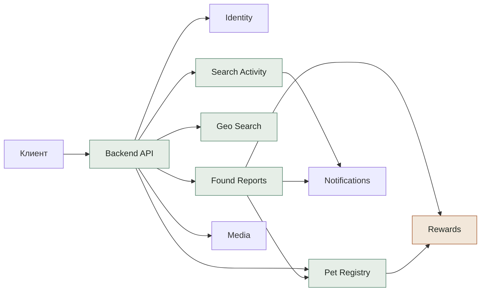
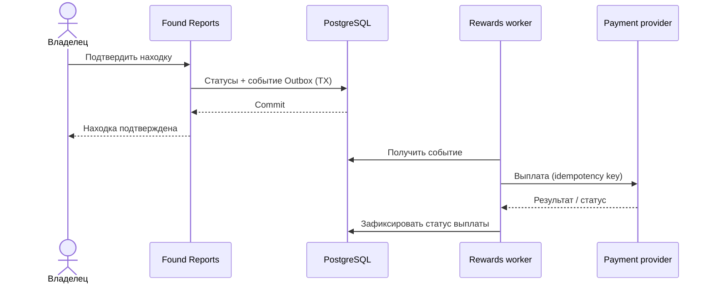
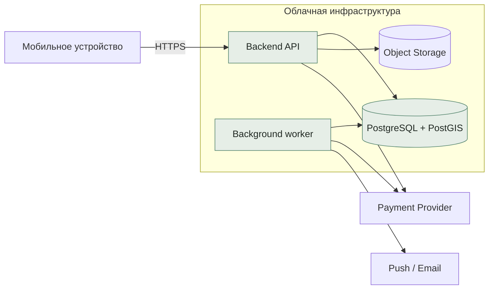

# Where’s<br>Fluffymon?

## Сервис поиска пропавших питомцев

<p class="meta">
  [Имена участников]
  <br>
  Архитектура программного обеспечения · 2026
</p>

<!--
Экспозиция здесь!
-->

---
layout: ff-split
section: 01 / Контекст и бизнес-цели
---

# Задача и контекст

Сервис объединяет владельцев и участников поиска, собирает географические наблюдения и управляет вознаграждениями.

- Запуск в одном городе
- Развитие сообщества
- Расширение географии и монетизация

::right::


---
layout: ff-base
section: 01 / Стейкхолдеры
---

# Заинтересованные стороны

| Стейкхолдер | Интерес |
|---|---|
| Владелец питомца | Найти животное и получать актуальные наблюдения |
| Участник поиска | Координировать поиск, видеть ближайшие пропажи |
| Нашедший питомца | Получить вознаграждение после подтверждения |
| Компания-владелец | Развивать AR-продукты, сообщество и монетизацию |
| Рекламные партнёры | Получать доступ к целевой аудитории |
| Команда разработки | Поддерживать и развивать систему |

---
layout: ff-base
section: 02 / Архитектурные драйверы
---

# Архитектурные драйверы

<div class="driver-list">
  <div class="index">01</div><div class="term">Scalability</div><div>Рост аудитории и запуск в новых городах.</div>
  <div class="index">02</div><div class="term">Data integrity</div><div>Корректные состояния находок и денежных операций.</div>
  <div class="index">03</div><div class="term">Extensibility</div><div>Новые социальные и рекламные функции.</div>
</div>

<p class="small muted">Также рассматриваем: производительность, безопасность, отказоустойчивость, совместимость интеграций.</p>

<div class="placeholder">TODO · Согласовать приоритеты и количественные ASR: нагрузку, задержку геопоиска, гарантии выплат.</div>

---
layout: ff-base
section: 02 / Ограничения и предположения
---

# Ограничения и предположения

<div class="ff-grid cols-2">
  <FfPanel title="Из условия каты"><ul><li>Мобильная доступность, GPS и AR</li><li>Фото обязательно при заявке о находке</li><li>Выплата после подтверждения владельцем</li><li>Десятки владельцев и сотни участников на старте</li></ul></FfPanel>
  <FfPanel title="Наши предположения"><ul><li>Платёжный провайдер и предварительное финансирование</li><li>Облачная инфраструктура</li><li>Авторизация для публикации</li><li>Уведомления о новых наблюдениях</li></ul></FfPanel>
</div>

---
layout: ff-base
section: 03 / Use-Case View
---

# Ключевые сценарии использования

<div class="flowline">
  <FfPanel title="Создать объявление" number="01"><p>Владелец публикует описание, координаты, фото и возможную награду.</p></FfPanel>
  <FfPanel title="Внести информацию" number="02"><p>Участник сообщает о наблюдении или проверенной территории.</p></FfPanel>
  <FfPanel title="Найти питомца" number="03"><p>Нашедший отправляет фото; владелец подтверждает находку; сервис инициирует выплату.</p></FfPanel>
</div>

<div class="placeholder">TODO · Добавить ссылку на подробные Use Cases и BCE-таблицу в репозитории.</div>

---
layout: ff-base
section: 03 / Архитектурные альтернативы
---

# Выбор архитектурного стиля

| Критерий | Обычный монолит | Модульный монолит | Микросервисы |
|---|---|---|---|
| Сложность эксплуатации | Низкая | Низкая–средняя | Высокая |
| Разделение ответственности | Вариативно | Явные границы | Явные границы |
| Согласованность данных | Проще | Проще | Сложнее |
| Независимое масштабирование | Ограничено | Ограничено | Возможно |

<div class="ff-callout"><strong>Предварительный выбор:</strong> модульный монолит с фоновыми обработчиками.</div>
<div class="placeholder">TODO · Обосновать оценки через архитектурные драйверы и альтернативы.</div>

---
layout: ff-diagram
section: 04 / Logical View
---

# Ответственность компонентов



<p class="small muted">Эскиз логических компонентов. Стрелки обозначают зависимости и не требуют сетевого вызова.</p>

<div class="placeholder">TODO · Уточнить границы модулей и добавить модель сущностей.</div>

---
layout: ff-diagram
section: 04 / Process View
---

# Подтверждение находки и выплата



<p class="small muted">Черновик UC-09/10. Ошибки и конкурентные подтверждения раскрываются в альтернативных сценариях.</p>

---
layout: ff-split
section: 04 / Development View
---

# Организация разработки

Модульная декомпозиция помогает отделить предметные области без распределения каждого модуля по отдельным сервисам.

**Принцип:** взаимодействие через явные интерфейсы модулей.

<div class="placeholder">TODO · Уточнить зависимости и структуру проекта.</div>

::right::

```text
fluffymon/
├── client/
├── backend/
│   ├── identity/
│   ├── pets/
│   ├── search/
│   ├── reports/
│   ├── rewards/
│   ├── media/
│   └── notifications/
└── worker/
```

---
layout: ff-diagram
section: 04 / Deployment View
---

# Развёртывание и интеграции



<div class="placeholder">TODO · Уточнить число экземпляров, сеть, границы доверия и стратегию резервного копирования.</div>

---
layout: ff-adr
section: 05 / ADR-002 · Proposed
---

# Геопоиск без отдельного хранилища

<div class="decision"><strong>Решение:</strong> PostgreSQL + PostGIS для пространственных данных.</div>

<div class="ff-grid cols-2">
  <FfPanel title="Контекст и альтернативы"><ul><li>Поиск питомцев в заданном радиусе</li><li>SQL без пространственного расширения</li><li>Отдельный геопоисковый движок</li></ul></FfPanel>
  <FfPanel title="Последствия"><ul><li>Одно хранилище и пространственные индексы</li><li>Меньше эксплуатационной сложности</li><li>Зависимость от PostGIS и нагрузка на БД</li></ul></FfPanel>
</div>

<p class="small muted">TODO · Дополнить ADR количественным критерием выбора и результатами проверки.</p>

---
layout: ff-base
section: 05 / Каталог архитектурных решений
---

# Каталог архитектурных решений

| ADR | Решение | Статус |
|---|---|---|
| 001 | Объектное хранилище фотографий | Proposed |
| 002 | PostgreSQL + PostGIS | Proposed |
| 003 | Модульный монолит | Draft |
| 004 | Надёжная фоновая обработка выплат | Draft |
| 005 | AR-вычисления на клиенте | Draft |

<div class="ff-callout">Для каждого ADR: контекст → альтернативы → выбор → последствия → компромисс.</div>

---
layout: ff-base
section: 06 / Риски и компромиссы
---

# Риски и компромиссы

| Риск | Мера | Цена решения |
|---|---|---|
| Двойная выплата | Идемпотентность и сверка статуса | Состояния операций и дополнительная логика |
| Сбой платёжного API | Фоновая обработка | Возможная задержка выплаты |
| Неточный GPS | Учёт погрешности | Менее точные AR-метки |
| Рост нагрузки | Реплики приложения, индексы | Инфраструктурные расходы |

<div class="placeholder">TODO · Оценить вероятность, влияние и остаточный риск. Добавить план проверки архитектуры.</div>

---
layout: ff-base
section: 06 / Эволюция системы
---

# Эволюция архитектуры

<div class="flowline">
  <FfPanel title="MVP" number="01"><p>Один город. Объявления, наблюдения, подтверждение, выплаты, AR.</p></FfPanel>
  <FfPanel title="Рост" number="02"><p>Новые города, анализ нагрузки, масштабирование приложения.</p></FfPanel>
  <FfPanel title="Платформа" number="03"><p>Реклама, сообщество, интеграция с другими AR-продуктами.</p></FfPanel>
</div>

<div class="ff-callout">Выделяем отдельные сервисы только при подтверждённой потребности.</div>

---
layout: ff-hero
section: 07 / Итоги
closing: true
---

# Итоги

## Предварительная архитектура для запуска в одном городе с возможностью последующего масштабирования.

<p class="lead">Модульная декомпозиция, пространственный поиск и надёжная обработка выплат.</p>

<p class="small muted">[Ссылка / QR на репозиторий] · Вопросы</p>
