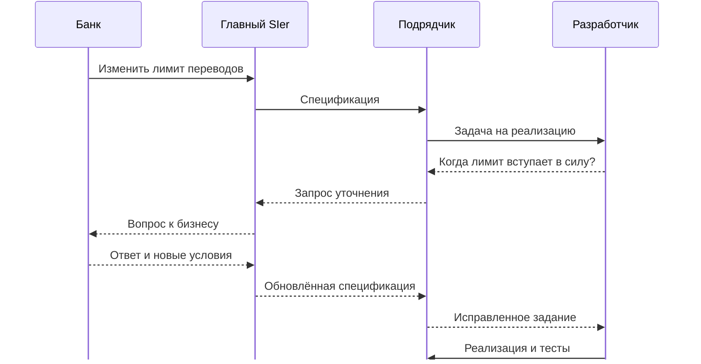

  

  

    
日本のソフトウェア産業

    <h1>Японский IT-парадокс</h1>
    
Почему страна высоких технологий   испытывает трудности с обновлением корпоративного ПО

  

  
日本 · JAPAN

<!--
Начинаем с противоречия: Япония известна сложной техникой, электроникой, автомобилями и играми. Но успехи этих отраслей не означают, что банковские и корпоративные информационные системы легко модернизировать. В докладе мы разберём, как устроен именно рынок корпоративной разработки: кто создаёт ПО, кто отвечает за архитектуру и почему менять устоявшуюся систему трудно.
-->

---

# Японский IT-парадокс

Технологические продукты, известные далеко за пределами Японии

  

    
    
Nintendo Switch

    
Nintendo · игровые платформы

  

  

    
    
Walkman

    
Sony · портативная электроника

  

  

    
    
Prius

    
Toyota · автомобильные системы

  

Почему страна, способная создавать сложнейшие технологические продукты, испытывает трудности с обновлением ПО?

<!--
Эти продукты знакомы даже людям вне IT. Но внутри корпораций существуют гораздо менее заметные системы: бухгалтерия, логистика, банковские платежи, управление производством. Именно их развитие и модернизация создают серьёзные трудности. Противоречие не означает, что «японцы плохо программируют»: речь о разных индустриальных моделях.
-->

---

# IT в Японии — это не только Sony, Nintendo и игры

Три разных рынка программного обеспечения

<table class="diverse-table" style="margin-top:22px;">
  <colgroup><col style="width:23%"><col style="width:32%"><col style="width:45%"></colgroup>
  <thead><tr><th>Направление</th><th>Компании и организации</th><th>Что делают разработчики</th></tr></thead>
  <tbody>
    <tr><td class="type">Продуктовое IT</td><td>Nintendo, Sony Interactive Entertainment, LINE Yahoo, Mercari</td><td>Игры, пользовательские сервисы, приложения и платформы</td></tr>
    <tr><td class="type">Корпоративное IT</td><td>NTT DATA, Fujitsu, NEC, TIS, SCSK</td><td>Банковские системы, ERP, логистика, интеграции, сопровождение</td></tr>
    <tr><td class="type">Внутренняя разработка</td><td>Банки, заводы, ритейл, транспортные компании</td><td>ПО для собственных процессов, цифровые сервисы, внутренние платформы</td></tr>
  </tbody>
</table>

<b>Фокус</b>Нас интересует корпоративное IT, где особенно заметна роль системных интеграторов.

<!--
Разделим рынок на три сегмента. В продуктовых компаниях разработка может быть основной компетенцией. В корпоративном IT большие системы часто создают поставщики услуг. У крупных банков и заводов есть и собственные отделы, но их роль может отличаться от американской практики. Это не противопоставление «хорошего» и «плохого»: разные сегменты выполняют разные задачи.
-->

---

# SIer — кто пишет код для японских корпораций?

  
<strong>SIer (System Integrator)</strong> — компания, которая проектирует, разрабатывает, интегрирует и сопровождает информационные системы для других организаций.

  

    01 / VENDOR
    <h3 style="margin-top:13px;">При производителях</h3>
    
Возникли вокруг производителей вычислительной техники и IT-платформ.

    
Fujitsu, NEC, Hitachi

  

  

    02 / USER
    <h3 style="margin-top:13px;">Дочерние IT-компании</h3>
    
Созданы крупными банками и промышленными группами для развития их систем.

    
Финансы, промышленность, ритейл

  

  

    03 / INDEPENDENT
    <h3 style="margin-top:13px;">Независимые</h3>
    
Берут проекты от заказчиков и крупных интеграторов.

    
Системная интеграция и разработка

  

<!--
SIer — один из ключевых терминов доклада. Например, крупный банк не всегда нанимает полную команду для нового продукта; он может заключить контракт с компанией, специализирующейся на внедрении корпоративных систем. Интеграторы бывают связаны с производителями оборудования, выросли из подразделений заказчиков или независимы. Следующий вопрос — где физически сосредоточены IT-специалисты.
-->

---

# Где работают IT-специалисты?

  
Доля IT-специалистов 

  

    <i style="background:#bf2340;"></i>В IT-компаниях
    <i style="background:#8b9db0;"></i>В компаниях других отраслей
  

  

🇯🇵 Япония

72%

28%

  

🇩🇪 Германия

38,6%

61,4%

  

🇺🇸 США

34,6%

65,4%

<b>Вывод</b>В Японии IT-кадры исторически намного сильнее сосредоточены в профильных IT-компаниях, чем непосредственно у заказчиков.

<!--
Это важное измеримое различие. В Японии 72% IT-специалистов работали в специализированных IT-компаниях. В США — около 35%, в Германии — около 39%. Это не означает, что каждый из японских специалистов занят аутсорсингом, но показывает концентрацию технических кадров. Теперь перейдём от места работы сотрудников к тому, как интеграторы распределяют проекты.
-->

---

# Почему в японии выбирают подрядчиков?

Три исторические причины, из которых выросла модель SIer

  

    
01 · ИСТОРИЯ РЫНКА

    <h3>ПО вместе с компьютером</h3>
  

  

    
02 · СОТРУДНИКИ

    <h3>Долгосрочный найм</h3>
  

  

    
03 · БИЗНЕС-ПРОЦЕССЫ

    <h3>Своя система под свои правила</h3>
  

Эти решения были рациональны для своего времени — и создали устойчивый спрос на системных интеграторов.

<!--
Почему именно Япония исторически так полагалась на подрядчиков? Три взаимосвязанные причины. Первая — рынок вырос из эпохи больших компьютеров: Fujitsu, NEC и другие поставщики поставляли оборудование, программное обеспечение и услуги внедрения вместе. В США независимый рынок стандартного ПО начал развиваться раньше; известная веха — отделение IBM продажи многих программ и услуг от оборудования в 1969 году. Это сравнение тенденций, а не утверждение, что в США не было заказной разработки, а в Японии — готовых продуктов. Вторая причина — долгосрочный найм в крупных японских компаниях. Когда в проекте сегодня нужно 100 инженеров, а после запуска лишь 20, заказчику проще заключить контракт на временную команду, чем создавать постоянный штат и потом сокращать его. Третья причина — стремление сохранять собственные процессы, подгоняя ПО под бизнес, а не наоборот. Так заказы на индивидуальные системы снова и снова приходили к знакомым интеграторам. Это были понятные хозяйственные решения, которые в итоге закрепили отраслевую модель. Теперь посмотрим, как внутри неё распределяются проекты.
-->

---

# Как устроена цепочка IT-подрядчиков

Почему код пишет не тот, кто общается с заказчиком?

  

    <h3>1. Заказчик — банк или корпорация</h3>
    
Формулирует бизнес-задачу, выделяет бюджет и заказывает разработку.

  

  

    <h3>2. Генеральный подрядчик — крупный SIer</h3>
    
Проектирует систему, управляет проектом и отвечает перед заказчиком.

  

  

    <h3>3. Подрядчики второго уровня</h3>
    
Получают отдельные части проекта: подсистемы, интеграции и модули.

  

  

    <h3>4. Субподрядчики — команды разработчиков</h3>
    
Пишут код, тестируют и сопровождают отдельные компоненты.

  

<!--
Пирамида — условная схема, а не устройство всех японских проектов. Сверху бизнес-заказчик, ниже генеральный интегратор, который несёт ответственность по контракту, затем фирмы, выполняющие части проекта, и субподрядчики. Модель помогает масштабировать труд и привлекать специалистов, но создаёт дистанцию между реальным пользователем и инженером.
-->

---

# Как выглядит разработка в такой системе?

Кейс: банк просит добавить изменение лимита переводов

<!--
Этот пример вымышленный, но показывает типовой организационный риск. Инженер видит, что требование неоднозначно. Вместо быстрого обсуждения с владельцем продукта вопрос путешествует по договорной цепочке. Не стоит утверждать, что вся Япония работает строго по Waterfall, однако тяжёлая документация и этапность часто сочетаются с такой структурой. Контраст — команды, где бизнес и <strong> инженеры </strong> взаимодействуют напрямую.
-->

---

# У кого находится инженерная экспертиза?

Доля компаний, развивающих внутреннюю разработку

  

🇯🇵 Япония

39%

  

🇩🇪 Германия

59,2%

  

🇺🇸 США

83,5%

Может ли организация эффективно управлять сложным программным продуктом, если большую часть знаний о нём хранят внешние подрядчики?

Опрос 2025 года.

<!--
На предыдущем графике мы сравнивали, где работают IT-специалисты, а теперь — насколько сами компании развивают внутренние инженерные компетенции. По исследованию, 39% в Японии против 59,2% в Германии и 83,5% в США. Эта величина объединяет тех, кто развивает внутреннюю разработку сейчас, и тех, кто уже сделал её в необходимом объёме. Если архитектуру и детали проекта знают только внешние специалисты, смена подрядчика и модернизация становятся сложнее.
-->

---

# Legacy: когда система работает, но менять её трудно

Легаси — это не возраст кода, а стоимость и риск его изменения

  

1
Накопленные зависимости

  

2
Недостаток документации

  

3
Потеря инж. знаний

  

4
Устаревшая архитектура

  

5
Старые технологии

  
Пример с банком

  
Десятилетиями добавляют счета, кредиты, банкоматы, переводы, мобильный банк. Новые функции зависят от старой бизнес-логики — переписать всё одним шагом рискованно.

<!--
Legacy не означает просто COBOL или старую базу данных. Даже современно написанная система может превратиться в легаси, если невозможно безопасно внести изменение. В банке в течение десятилетий к основным операциям подключают новые модули, интерфейсы и сервисы. Проблема не в том, что всё обязательно работает плохо, а в том, что любое изменение затрагивает множество скрытых взаимосвязей. У японского заказчика эта сложность иногда усугубляется распределением знаний между подрядчиками.
-->

---

# Почему старое ПО продолжает существовать?

  

    

1

<h3>Слишком критично для бизнеса</h3>
Сбой миграции способен остановить банк, завод или логистику.

    

2

<h3>Знания распределены</h3>
Бизнес-контекст у заказчика, детали кода — у интегратора и подрядчиков.

    

3

<h3>Поддерживать проще в краткосрочном периоде</h3>
Большое обновление дорого и рискованно, текущая поддержка привычна.

  

  

    
Замкнутый круг

    
  

<!--
Три причины действуют вместе. Во-первых, система критична: переключение нельзя проводить без сложной проверки. Во-вторых, знания могут быть разбросаны по разным организациям. В-третьих, продлевать контракт на поддержку дешевле и проще для краткосрочного бюджета, чем рискнуть модернизацией. Но каждое отложенное изменение усиливает зависимость и может повышать стоимость будущих работ. Это не уникальная для Японии проблема, но её модель подрядчиков делает вопрос особенно важным.
-->

---

# Mizuho Bank: восемь крупных IT-сбоев

  
<strong>8</strong><small>сбоев, затронувших клиентов</small>

  

    
Период

    
Февраль — сентябрь 2021

    
Один из крупнейших японских банков. Инциденты затронули банкоматы, отделения и переводы.

  

  
<h3>Что увидели клиенты</h3><ul><li>Банкоматы не возвращали карты и книжки</li><li>Часть операций и переводов была недоступна</li><li>Временные остановки обслуживания</li></ul>

  
<h3>Что выявило расследование</h3><ul><li>Недостаточные проверки и подготовка к сбоям</li><li>Проблемы сопровождения и контроля подрядчиков</li><li>Недооценка IT-рисков руководством</li></ul>

Этот кейс не доказывает, что все сбои вызваны многоуровневым подрядом: причины были одновременно техническими и управленческими.

<!--
В 2021 году банк Mizuho пережил восемь крупных инцидентов. Один из самых заметных случился 28 февраля: при операциях с данными возникла цепь ошибок, что привело к недоступности части банкоматов; некоторые устройства удерживали карты и книжки. Регулятор указал не только на недостатки тестирования, но и на ошибки в управлении эксплуатацией, отношениями с подрядчиками и рисками. Это показывает, что надёжность — свойство и кода, и организационной системы. Не следует приписывать все восемь инцидентов единственной причине.
-->

---

# «Цифровой обрыв 2025 года»

Почему японское правительство забило тревогу?

  

  

    
Оценка риска

    
¥12 трлн

    <h3>потенциальных потерь ежегодно</h3>
    
Из-за устаревающих систем, нехватки кадров и трудной модернизации бизнес может терять эффективность и возможности для роста.

    
Прогноз негативного сценария, сформулированный в 2018 году для периода после 2025-го. Это не измеренные убытки 2025 года.

  

<!--
В 2018 году японское Министерство экономики ввело выражение «2025 Digital Cliff». Оно предупреждало: при сохранении накопленных проблем экономика может нести огромные ежегодные потери — до 12 триллионов иен. Это оценка риска, а не факт, что в 2025 году столько денег исчезло. Наступление 2025 года не означало внезапную поломку всех систем. Государство продолжило искать меры для модернизации, и в 2025 году выпустило новый доклад по legacy.
-->

---

# Достаточно ли просто переписать старую систему?

<table class="diverse-table compact" style="margin-top:18px;">
  <colgroup><col style="width:23%"><col style="width:43%"><col style="width:34%"></colgroup>
  <thead><tr><th>Подход</th><th>Как работает</th><th>Основной риск</th></tr></thead>
  <tbody>
    <tr><td class="type">Полная замена</td><td>Создать новую систему и переключить пользователей</td><td>Большая и сложная миграция</td></tr>
    <tr><td class="type">Постепенная модернизация</td><td>Заменять функциональность по частям</td><td>Совместная работа старого и нового</td></tr>
    <tr><td class="type">API-обёртка</td><td>Оставить ядро, открыть новые интерфейсы</td><td>Старые ограничения сохраняются</td></tr>
    <tr><td class="type">Готовое решение</td><td>Перейти на стандартный корпоративный продукт</td><td>Нужно менять бизнес-процессы</td></tr>
  </tbody>
</table>

  
Strangler Fig

  
Постепенная замена: новая система принимает на себя функции старой, пока её можно будет безопасно вывести из эксплуатации.

<!--
Нет одного универсального решения. Полная замена даёт новую архитектуру, но требует сложной миграции. API-обёртка помогает развивать новые интерфейсы, не трогая ядро, однако сохраняет существующие ограничения. Постепенная замена снижает риск больших переключений. Паттерн Strangler Fig полезен для объяснения этой стратегии: новые сервисы постепенно вытесняют функции старых. Но без знания процессов и управленческой поддержки даже хорошая архитектура не спасёт проект.
-->

---

# Что предлагает сама Япония?

  

    
Пример изменений

    
Токийское правительство

    
<b>Waterfall</b>→<b style="color:#bf2340">Agile</b>

  

  
В отдельных цифровых проектах внедряли владельцев продукта, пользовательские истории, итерации и более тесную межведомственную работу. Это пример изменения процесса, а не переход всей администрации разом.

<table class="diverse-table compact">
  <colgroup><col style="width:50%"><col style="width:50%"></colgroup>
  <thead><tr><th>Традиционная модель</th><th>К чему стремятся реформы</th></tr></thead>
  <tbody>
    <tr><td>Заказчик передаёт техническую задачу</td><td>Заказчик участвует в развитии продукта</td></tr>
    <tr><td>Экспертиза преимущественно у поставщика</td><td>Собственные инженерные компетенции</td></tr>
    <tr><td>Проект ради сдачи результата</td><td>Непрерывное улучшение продукта</td></tr>
    <tr><td>Долгое согласование изменений</td><td>Быстрая проверка гипотез и приоритетов</td></tr>
    <tr><td>IT как обслуживающая функция</td><td>IT как часть конкурентного преимущества</td></tr>
  </tbody>
</table>

<!--
Государственные рекомендации не сводятся к «выучите новый язык» или «поставьте облака». Нужны более сильные собственные IT-команды, участие руководства, связь бизнеса с инженерами и новые подходы к контрактам. Хороший конкретный пример — Agile-проекты Токийского столичного правительства, где использовались роли product owner, пользовательские истории и итерации. Не стоит обещать, что переход на Agile автоматически исправит все системные проблемы.
-->

---

# Почему от этой модели трудно отказаться?

Сильные стороны прежней системы постепенно превратились в ограничения

  

01 · КОД
<h3>Глубокая кастомизация</h3>
Программы тесно связаны с уникальными бизнес-процессами и интеграциями заказчика.

  

02 · ЗНАНИЯ
<h3>Зависимость от поставщика</h3>
История решений и детали архитектуры часто известны специалистам подрядчика.

  

03 · ЛЮДИ
<h3>Недостаток своих команд</h3>
Для самостоятельного развития системы нужно создавать внутренние инженерные компетенции.

  

04 · ПЕРЕХОД
<h3>Цена перемен</h3>
Миграция означает новые контракты, изменения процессов и технические риски.

Поменять поставщика можно на бумаге. Перенести знания, систему и ответственность гораздо сложнее.

<!--
В начале доклада мы разобрали, почему Япония выбрала модель SIer: история поставщиков оборудования, долгосрочный найм и спрос на ПО под собственные процессы. Теперь посмотрим, почему привычную модель нельзя просто отменить управленческим решением. За десятилетия системы глубоко адаптированы к бизнесу, архитектурные знания сосредоточены у поставщиков, а внутри компаний часто нет достаточного количества опытных инженеров для немедленного самостоятельного сопровождения. При смене модели нужно одновременно перенести знания, изменить контракты и ответственность, развить внутреннюю команду и модернизировать технологию. Поэтому реформы идут постепенно.
-->

---

# Почему проблема остаётся важной сегодня?

Дело уже не только в старом коде

  

01
<h3 style="margin-top:14px;">Обновить системы</h3>
Миграция данных, отказоустойчивость, постепенный вывод legacy из эксплуатации.

  

02
<h3 style="margin-top:14px;">Вернуть экспертизу</h3>
Внутренние команды, архитектурные знания, более прямой диалог инженеров с бизнесом.

  

03
<h3 style="margin-top:14px;">Изменить процессы</h3>
Гибкая поставка, ответственность за продукт, новые роли заказчиков и подрядчиков.

<b>Главное</b>Внедрить новые инструменты проще, чем изменить устоявшуюся модель принятия решений.

<!--
Финальный разворот: сама технология уже давно доступна. Япония не испытывает недостатка в производителях оборудования, IT-компаниях и квалифицированных специалистах. Сложнее пересобрать компетенции, контракты и ответственность. Поэтому путь изменений состоит не из одного проекта по переписыванию кода, а из комплексной модернизации технологий и организации работы.
-->

---

# Что в итоге?

  

01
<h3>Не только старый код</h3>
Технический долг усиливается организационной сложностью, контрактами и распределением знаний.

  

02
<h3>Аутсорсинг — не зло</h3>
Риск возникает, когда заказчик теряет способность самостоятельно управлять собственной системой.

  

03
<h3>Реформировать нужно процесс</h3>
Новые инструменты работают лучше, когда бизнес и разработчики могут принимать решения вместе.

Что важнее для качества ПО: современные технологии или организация людей, которые их используют?

<!--
Заключение. Япония интересна тем, что даёт нам редкую возможность увидеть связь между организацией отрасли и устройством программных систем. Legacy существует во всём мире, но японская концентрация разработчиков у поставщиков и многоуровневый подряд помогают понять особые трудности. Хороший инженер должен думать не только о коде, но и об архитектуре процессов, ответственности и сохранении знаний.
-->

---

  

  

    
日本 · JAPAN

    <h1 style="margin-top:16px;">Спасибо за внимание!</h1>
    
Вопросы?

  

<!--
Спасибо за внимание. Готов обсудить, где заканчиваются преимущества привлечения внешних подрядчиков и начинается потеря инженерной самостоятельности.
-->
